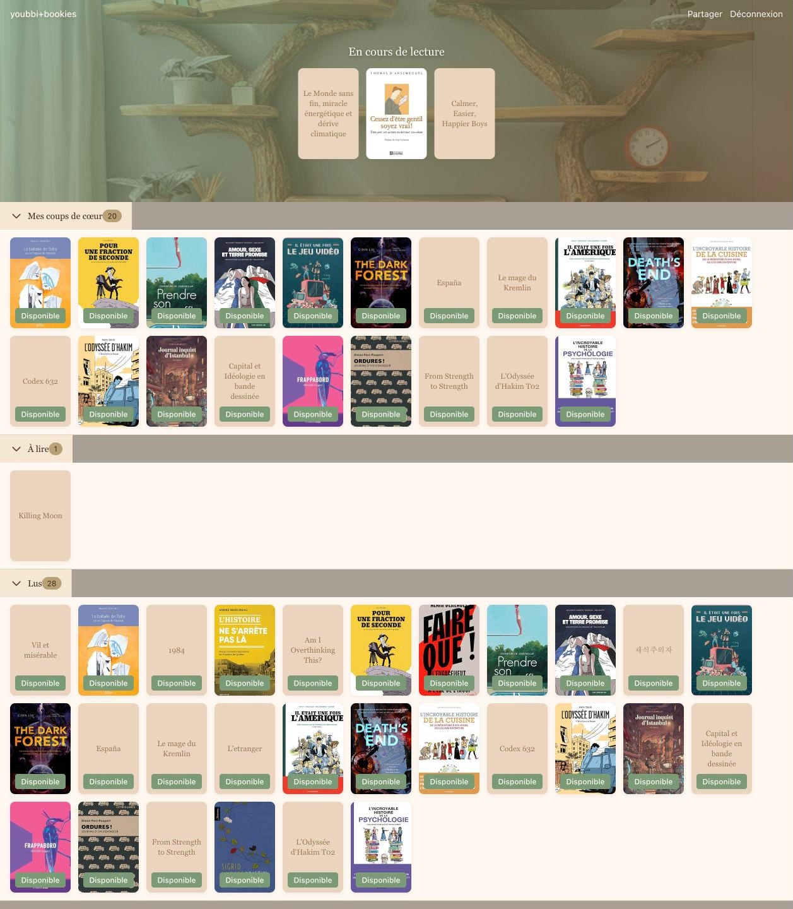

# Bookies

**Your shelf, shared with friends.**

Bookies keeps track of every book you own and read, and shares your shelf with a small, private circle of friends: what you're reading now, what you loved, and what's free to borrow.



## What it does today

- **Your whole library in one place.** Shelves for currently reading, favourites, to read and read.
- **Add books fast.** Search by title or scan the ISBN barcode with your phone camera.
- **Bring your history.** Import your library from Goodreads with your profile URL.
- **Mark what you'll lend.** Every book shows whether it's available.
- **Share your shelf.** Each reader gets a public shelf page at `/shelf/:username`.
- **No passwords.** Sign in with a magic link or Google.

**Next:** friend circles, borrow requests and loan tracking.

## Stack

React 18 · TypeScript · Vite (PWA) · Tailwind CSS · Supabase (Postgres, auth, row-level security) · Vercel

## Run it locally

You need Node 20+ and a [Supabase](https://supabase.com) project.

```bash
npm install
cp .env.example .env.local   # add your Supabase URL and anon key
```

Apply the schema in `supabase/migrations/` to your Supabase project (SQL editor or `supabase db push`), then:

```bash
npm run dev      # http://localhost:5173
npm test         # unit tests (Vitest)
npm run check    # typecheck, lint, format
```

## About

Built by [Hubert Lamonde](https://hubertlamonde.com) as one of a handful of apps I make with AI. See the others at [hubertlamonde.com](https://hubertlamonde.com).

## License

[MIT](LICENSE)
